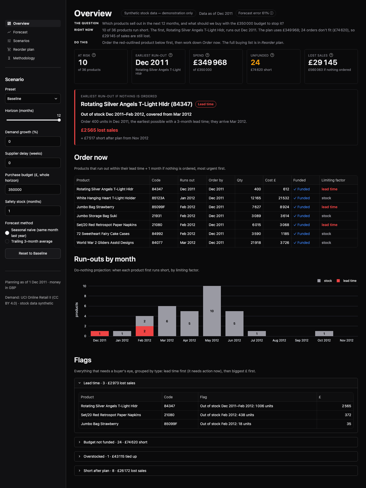
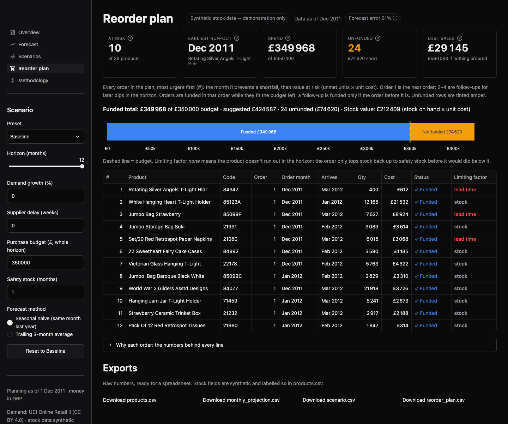

# Inventory run-out planner

A what-if purchasing planner in Streamlit. It answers the questions a purchasing manager usually works through in a spreadsheet each month: **which products run out, when, what is holding each one back, and what should I reorder within this month's budget?**

Demand is real: monthly units for 36 products of a UK online gift and homeware wholesaler (UCI Online Retail II, Dec 2009 – Nov 2011). Stock on hand, lead times, MOQ, unit cost, warehouse capacity and open inbound orders are **synthetic**, generated with a fixed seed, and labelled as such on every page.



## What it shows

| Page | What you get |
| --- | --- |
| Overview | KPI cards, the earliest run-out with its limiting factor, the products to order now, run-outs by month, every flag (lead-time blocked, unfunded, overstocked) |
| Forecast | Per product: two years of real demand, the forecast, projected stock with and without the next order, and the month-by-month table behind it |
| Scenarios | The current assumptions and all five presets side by side (products at risk, earliest run-out, spend) |
| Reorder plan | Ranked list of the next order per product, budget against spend, the reason behind every line with its numbers, 4 CSV exports |
| Methodology | Every formula, the data cleaning, the synthetic-data rules and the hand-calculated test cases |

The sidebar holds the scenario: horizon (6–12 months), demand growth, supplier delay, purchase budget, safety stock and forecast method. Presets: **Baseline**, **Peak season +25%**, **Supplier delay +3 weeks**, **Tight budget**, **Efficiency**. Editing any input switches the preset to **Custom**; picking a preset reloads its values. **Reset to Baseline** puts everything back. Every page recalculates from the same scenario, so a KPI shows the same value everywhere. Invalid inputs (e.g. a negative budget) show a clear message instead of numbers.

## Results on the real demand data (Baseline: £100 000 budget, 12 months, 1 month safety stock)

| | Baseline | Peak season +25% | Supplier delay +3 weeks | Tight budget (£50 000) | Efficiency (½ month safety) |
| --- | --- | --- | --- | --- | --- |
| Products at risk (run out within lead time + 1 month: order now) | 7 | 12 | 14 | 7 | 7 |
| Earliest run-out | Dec 2011 · ROTATING SILVER ANGELS T-LIGHT HLDR (84347), lead time | Dec 2011 · JUMBO BAG RED RETROSPOT (85099B), lead time | Dec 2011 · ROTATING SILVER ANGELS T-LIGHT HLDR (84347), lead time | Dec 2011 · ROTATING SILVER ANGELS T-LIGHT HLDR (84347), lead time | Dec 2011 · ROTATING SILVER ANGELS T-LIGHT HLDR (84347), lead time |
| Funded / suggested spend | £99 993 / £124 083 | £99 984 / £162 296 | £99 772 / £127 909 | £49 834 / £124 083 | £94 251 / £111 367 |
| Unfunded orders | 5 | 14 | 8 | 24 | 1 |

A +3-week supplier delay pushes the open purchase order for JUMBO BAG RED RETROSPOT (85099B) from January into February, so the product runs out in January instead of after April. In the table it shows as products at risk jumping from 7 to 14; the Forecast page shows that product's projection month by month.



## How the numbers are made

- **Forecast:** same calendar month last year × (1 + growth %), or the mean of the last 3 months × (1 + growth %). Rounded half up to whole units.
- **Projection:** available = opening + inbound; shipped = min(demand, available); unmet = demand − shipped; closing = available − shipped. Stock never goes negative; a shortfall is unmet demand. Run-out = first month with unmet demand.
- **Lead time:** `ceil((lead time weeks + delay weeks) × 7 / 30.44)` months.
- **Next order:** triggered by the first month below safety stock; ordered early enough to arrive by then; quantity = 3 months of forecast + safety stock − stock available at arrival, at least the MOQ, at most the free warehouse capacity.
- **Ranking and budget:** run-out month, then value at risk (unmet units × unit cost). Funded in rank order while each order fits the budget left.
- **Limiting factor:** *lead time* (an order now arrives too late), *capacity*, *budget*, *stock* (ordering now fixes it) or *none*.

Full detail on the Methodology page and in [`specs/inventory-runout-planner.md`](specs/inventory-runout-planner.md).

## Tests

- 40 acceptance tests, one per acceptance criterion in the spec, including 8 hand-calculated cases (e.g. 100 units in stock, 60 a month, lead time 4 weeks → runs out Jan 2012, order 200 units = 180 + 60 − 40, £400.00).
- 341 unit tests on the calculation core: property tests over random products and scenarios (stock is conserved, never negative, spend ≤ budget, ranking order), every input boundary, data-file error paths, exact half-up rounding.
- 229 more Streamlit `AppTest` checks on top of the acceptance tests: every page renders, the KPI cards match across all 5 pages, presets move the KPIs, Reset restores them, bad input shows the error, missing data files show a clear message.

## Run it yourself

```bash
uv sync
make run                       # http://127.0.0.1:8786
make test                      # unit tests
uv run pytest tests/acceptance # acceptance tests
```

The committed `data/` files are enough to run the app. To rebuild them from the original dataset (downloads ~45 MB, checks its SHA-256):

```bash
uv run python scripts/build_data.py
```

Screenshots: start the app, then `uv run python tools/screenshots.py` (needs `uv run playwright install chromium` once).

Stack: Python 3.12, Streamlit 1.67 (pinned), Plotly, pandas, Pydantic. The calculation core in `src/inventory_runout_planner/` has no Streamlit imports; the app in `app.py` + `app_pages/` only displays its results. `requirements.txt` is exported from `uv.lock` for Streamlit Community Cloud.

## Data and licence

Demand data: Chen, D. (2012). *Online Retail II*. UCI Machine Learning Repository. CC BY 4.0. https://doi.org/10.24432/C5CG6D

Only product-level monthly aggregates are committed (no customer ids, invoices or countries). Stock, lead times, MOQ, unit cost (60 % of the real median selling price), capacity and inbound orders are synthetic and for demonstration only.
